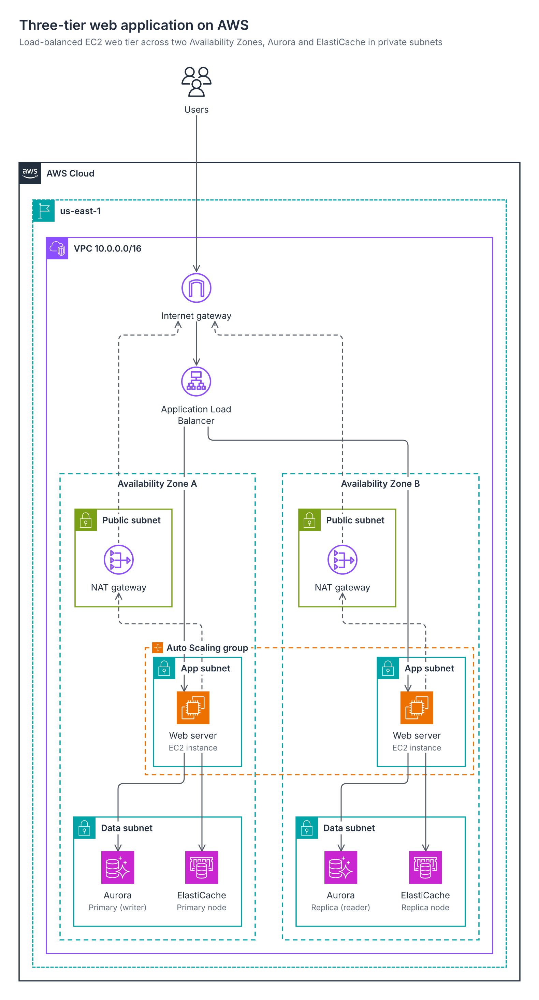
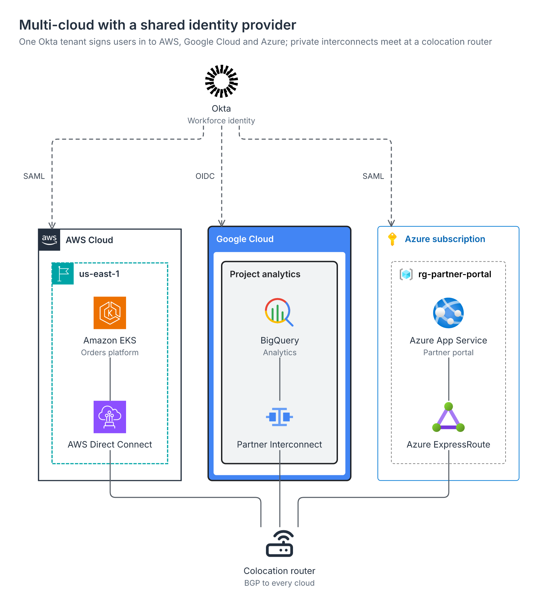
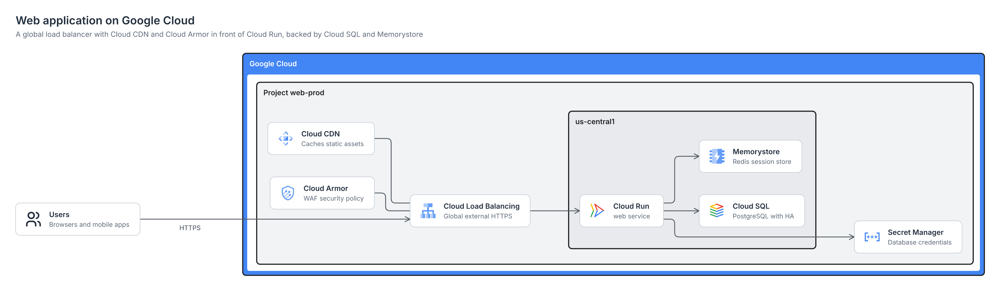
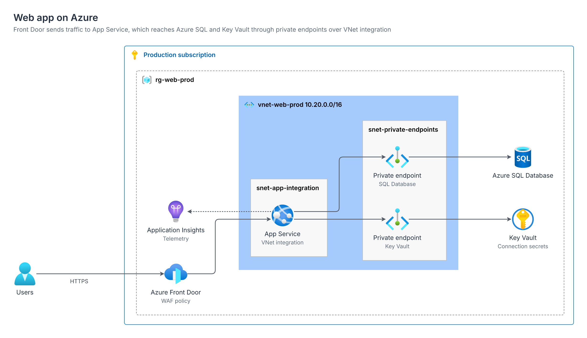
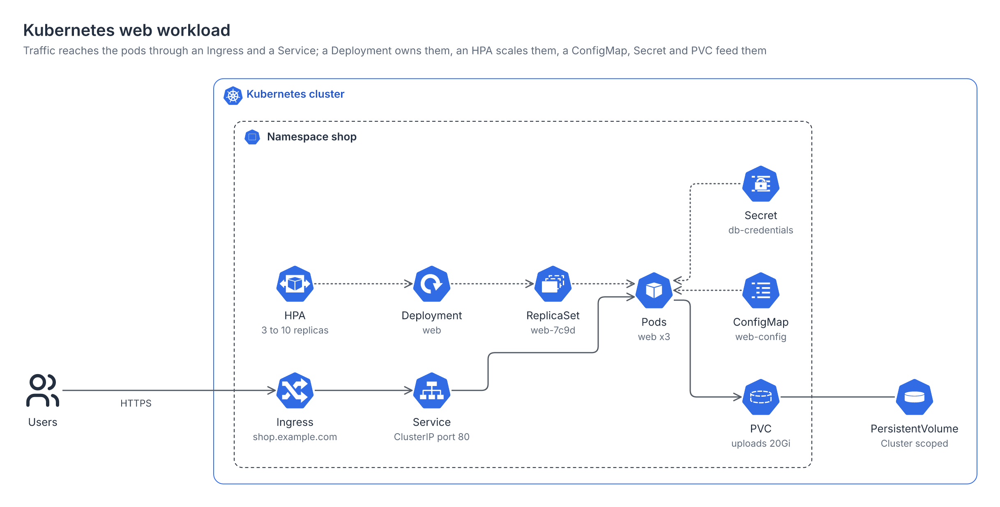
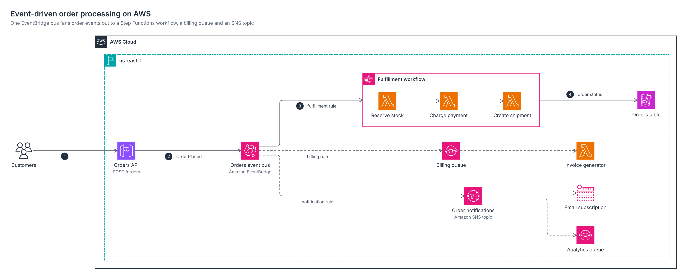
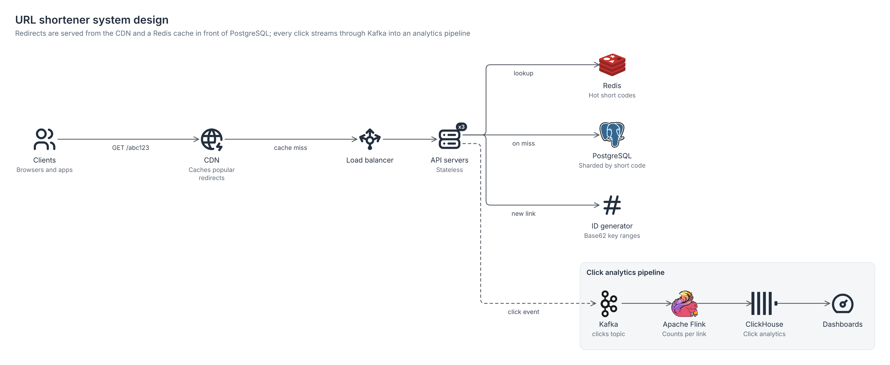
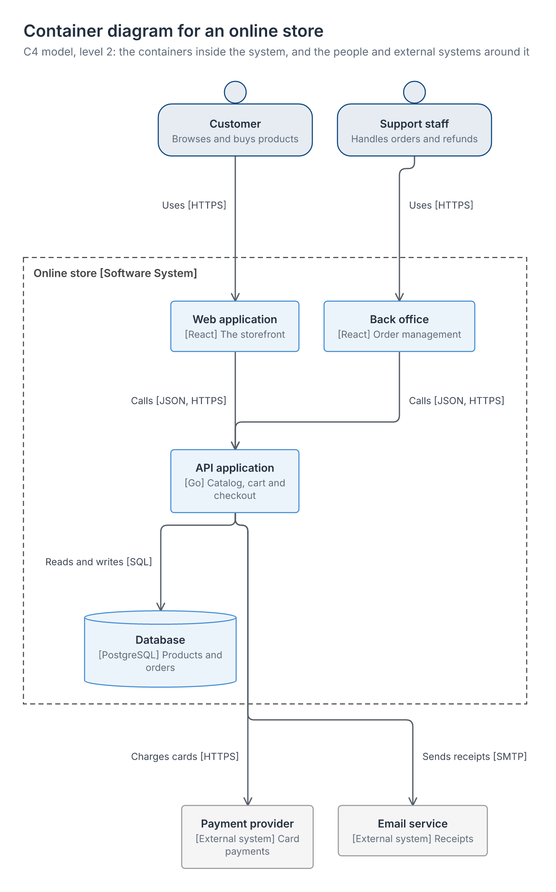
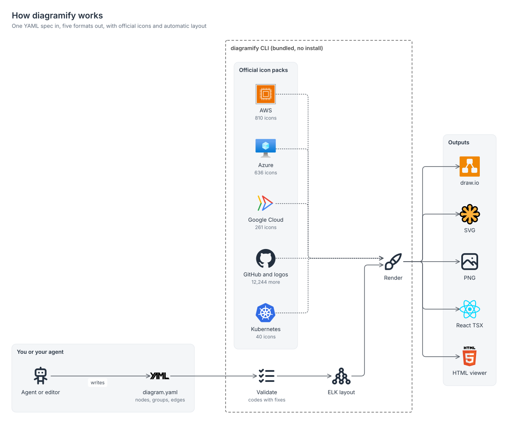

<div align="center">

<picture>
  <source media="(prefers-color-scheme: dark)" srcset="docs/hero-dark.svg">
  <source media="(prefers-color-scheme: light)" srcset="docs/hero-light.svg">
  
</picture>

# diagramify

**Architecture and system design diagrams with official AWS, Azure, Google Cloud, Kubernetes and GitHub icons.**<br>
One YAML spec in; SVG, PNG, editable draw.io, a React component and an HTML viewer out.

[](https://github.com/Sagargupta16/diagramify/actions/workflows/ci.yml)


</div>

The diagram above is the [aws-serverless-api](skills/diagramify/examples/aws-serverless-api.yaml) example: 30 lines of YAML, laid out and rendered by diagramify. The edges move because the SVG carries a small CSS animation, which GitHub keeps.

## What you get

- **Official icons, not look-alikes.** 13,991 icons rebuilt from each vendor's own download, with the download pinned by checksum: AWS (810), Azure (636), Google Cloud (261), Kubernetes (40), GitHub Octicons (399), plus 5,559 tech logos and 6,286 neutral symbols for system design.
- **Official conventions.** AWS groups follow the AWS Architecture Icons deck (borders, dashes, corner tiles, label placement, open arrowheads, numbered callouts); Google Cloud and Azure groups are measured from their own reference diagrams. Every value cites its source in [styles.md](skills/diagramify/references/styles.md).
- **Automatic layout.** The Eclipse Layout Kernel places nested boundaries, routes edges at right angles, joins fan-in and fan-out into trunks and keeps your order where it can. No coordinates to write.
- **Five outputs from one spec.** SVG for READMEs and docs, PNG for slides and chat, `.drawio` you can keep editing, a TSX component for React sites, and a standalone HTML viewer with dark mode, pan and pinch zoom.
- **Made for agents.** A skill with a fast path and authoring rules, a JSON Schema, 392 short aliases (`aws:s3`, `azure:aks`, `k8s:deploy`), ranked icon search, and a validator whose every finding names the subject and the fix.
- **No install.** The CLI, layout engine, PNG renderer, fonts and icons ship in the skill folder. Node.js 22 or newer is all it needs.

## Install

Claude Code plugin:

```
/plugin marketplace add Sagargupta16/diagramify
/plugin install diagramify@diagramify
```

Any agent that reads [Agent Skills](https://agentskills.io) (Codex, Cursor, Gemini CLI, Kiro and others):

```bash
npx skills add Sagargupta16/diagramify
```

Only the CLI:

```bash
git clone https://github.com/Sagargupta16/diagramify
node diagramify/skills/diagramify/scripts/diagramify.mjs doctor
```

## Quick start

Ask your agent for a diagram ("draw the architecture of this repo", "a three-tier web app on AWS across two Availability Zones", "turn this Mermaid flowchart into a Google Cloud diagram"). It writes a spec, validates it, renders it and checks the picture. Or write one yourself:

```yaml
title: Orders API
direction: right
groups:
  cloud:  { type: aws:cloud }
  region: { type: aws:region, label: eu-west-1, in: cloud }
nodes:
  users: { icon: aws:users, label: Customers }
  api:   { icon: aws:api-gateway, in: region }
  fn:    { icon: aws:lambda, label: Create order, in: region }
  table: { icon: aws:dynamodb, label: Orders, in: region }
edges:
  - users -> api: HTTPS
  - api -> fn -> table
```

```bash
node skills/diagramify/scripts/diagramify.mjs render orders.yaml -f svg,png
```

Labels default to the official service names, so `{ icon: aws:lambda }` reads "AWS Lambda". Edges use arrows: `->` solid, `-->` dashed, `..>` dotted, `==>` thick, `<->` both ways, `a -> b, c` to fan out. The full format is in [spec.md](skills/diagramify/references/spec.md).

## Gallery

Every picture below is rendered from a spec in [skills/diagramify/examples](skills/diagramify/examples) and re-rendered by CI; `diagramify init <name>` copies any of them as a starting point. All of them, with commands, in [examples/README.md](examples/README.md).

| | |
| --- | --- |
| <a href="examples/aws-three-tier.svg"></a> | <a href="examples/multi-cloud.svg"></a> |
| [`aws-three-tier`](skills/diagramify/examples/aws-three-tier.yaml): VPC, two Availability Zones, public, app and data subnets, an Auto Scaling group drawn across both zones | [`multi-cloud`](skills/diagramify/examples/multi-cloud.yaml): each vendor's own group style side by side, joined at a colocation router |
| <a href="examples/gcp-web-app.svg"></a> | <a href="examples/azure-web-app.svg"></a> |
| [`gcp-web-app`](skills/diagramify/examples/gcp-web-app.yaml): Google Cloud product cards in the 2025 frame style | [`azure-web-app`](skills/diagramify/examples/azure-web-app.yaml): Front Door, App Service with VNet integration, private endpoints |
| <a href="examples/k8s-workload.svg"></a> | <a href="examples/aws-event-driven.svg"></a> |
| [`k8s-workload`](skills/diagramify/examples/k8s-workload.yaml): official Kubernetes icons, ownership edges dotted | [`aws-event-driven`](skills/diagramify/examples/aws-event-driven.yaml): EventBridge, Step Functions, SQS and SNS with numbered steps |
| <a href="examples/system-design-url-shortener.svg"></a> | <a href="examples/c4-container.svg"></a> |
| [`system-design-url-shortener`](skills/diagramify/examples/system-design-url-shortener.yaml): vendor-neutral system design with product logos | [`c4-container`](skills/diagramify/examples/c4-container.yaml): a C4 container view built from shapes |

## How it works

<picture>
  <source media="(prefers-color-scheme: dark)" srcset="docs/how-it-works-dark.svg">
  
</picture>

## Validation that tells you the fix

```text
$ diagramify validate orders.yaml
error DG101 node "fn" uses unknown icon "aws:lamda" {"node":"fn","icon":"aws:lamda"}
      fix: use icon "aws:lambda"
      fix: run `diagramify icons search lamda`
error DG108 unknown key "lable" in node "db" {"where":"node \"db\"","key":"lable"}
      fix: rename "lable" to "label"
failed: 2 error(s), 0 warning(s)
```

Spec errors (DG1xx) stop the render; composition warnings (DG2xx: an edge through a node, colliding labels, a diagram too wide to read) keep it going unless `--strict` is set. `render --json` writes every file atomically and prints a receipt with the size and SHA-256 of each output.

## Commands

| Command | Does |
| --- | --- |
| `render <spec> [-o base] [-f svg,png,drawio,tsx,html\|all] [--theme light\|dark\|both] [--animate]` | Validate, lay out, render. |
| `validate <spec> [--strict] [--json]` | Spec errors and composition warnings, each with fixes. |
| `icons search <words> [--pack aws]` | Ranked icon ids with official names. |
| `icons show <id>`, `icons list`, `icons packs` | Browse the catalog and its sources. |
| `styles` | Every group type and node shape. |
| `init [template]` | Start from one of the examples. |
| `import mermaid <flowchart.mmd>` | Turn an existing Mermaid flowchart into a spec, with official icons where the labels name real products. |
| `doctor`, `demo` | Check the install; render every example. |

## Icon packs

| Pack | Icons | Source |
| --- | ---: | --- |
| `aws` | 810 | [AWS Architecture Icons](https://aws.amazon.com/architecture/icons/), 2026-07-31 package |
| `azure` | 636 | [Azure Architecture Icons](https://learn.microsoft.com/en-us/azure/architecture/icons/) V24 |
| `gcp` | 261 | [Google Cloud icons](https://cloud.google.com/icons), 2025 product icons plus console icons |
| `k8s` | 40 | [Kubernetes community icons](https://github.com/kubernetes/community/tree/master/icons) |
| `github` | 399 | [GitHub Octicons](https://primer.style/octicons) |
| `logos` | 2,199 | [SVG Logos](https://github.com/gilbarbara/logos) |
| `si` | 3,360 | [Simple Icons](https://simpleicons.org) |
| `tabler` | 6,286 | [Tabler Icons](https://tabler.io/icons) |

A monthly workflow checks the vendors' pages for new releases and opens a PR with the updated packs. Icons, logos and trademarks belong to their owners and are used under the terms listed in [THIRD_PARTY_NOTICES.md](THIRD_PARTY_NOTICES.md); the AWS, Microsoft and Google terms allow them in architecture diagrams.

## Development

```bash
pnpm install
pnpm lint
pnpm typecheck
pnpm test
pnpm build                       # src/ -> skills/diagramify/scripts/diagramify.mjs
pnpm gallery                     # re-render examples/ and docs/
node scripts/check-repo.mjs      # dashes, links, counts, doc snippets, gallery freshness
pnpm sync-icons                  # rebuild icon catalogs (--latest re-pins new vendor releases)
```

See [CONTRIBUTING.md](CONTRIBUTING.md) for how the pieces fit and [SECURITY.md](SECURITY.md) for reporting issues.

## License

Code and docs: [MIT](LICENSE). Icons, fonts and the vendored engines keep their own licenses: [THIRD_PARTY_NOTICES.md](THIRD_PARTY_NOTICES.md).
