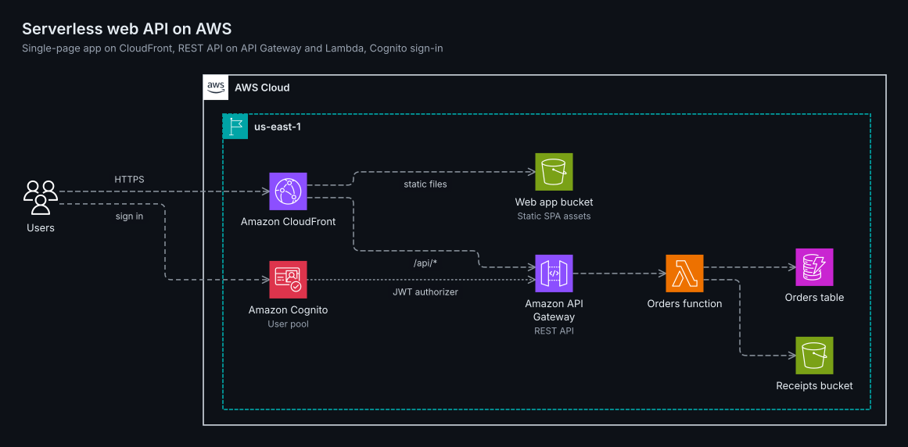

<div align="center">

<picture>
  <source media="(prefers-color-scheme: dark)" srcset="docs/hero-dark.svg">
  <source media="(prefers-color-scheme: light)" srcset="docs/hero-light.svg">
  
</picture>

# orrery

**Animated architecture and system design diagrams with official AWS, Azure, Google Cloud, Kubernetes, GitHub and IBM icons.**<br>
One YAML spec in; SVG, PNG, editable draw.io, a React component and an HTML viewer out.<br>
**[sagargupta.online/orrery](https://sagargupta.online/orrery/)**: every example in light and dark, with its spec and downloads.

[](https://github.com/Sagargupta16/orrery/actions/workflows/ci.yml)


</div>

The diagram above is [docs/hero.yaml](docs/hero.yaml): 40 lines of YAML, laid out and rendered by orrery in its default `stage` skin: the groups light, then the tiles, then a packet with a comet tail runs the numbered steps in order, lighting each line behind it, and every step badge pops as its packet leaves, on a loop. Every picture in this README is the stage skin; `skin: classic` (or `--skin classic`) draws the same layout in each vendor's own diagram style, with a packet along every edge. GitHub keeps the animation; the PNG of the same spec is a still frame.

## What you get

- **Official, current icons only.** 18,209 icons: AWS (810), Azure (636), Google Cloud (233), Kubernetes (40), GitHub Octicons (399) and IBM Carbon (2,776), plus 5,502 tech logos, 6,286 neutral symbols and Phosphor (1,527) in six weights for system design and business flows; your own SVGs work too, as `local:` icons drawn and checked with `orrery icons new` and `icons check`. The cloud packs are rebuilt from each vendor's own download, pinned by checksum. Google Cloud products get the icon Google's 2026 guide assigns them; deprecated sets and unofficial redraws of cloud icons are left out.
- **Official conventions.** AWS groups follow the AWS Architecture Icons deck (borders, dashes, corner tiles, label placement, open arrowheads, numbered callouts); Google Cloud and Azure groups are measured from their own reference diagrams. Every value cites its source in [styles.md](skills/orrery/references/styles.md).
- **Business flows too.** `kind:` turns the same spec into an ISO 5807 flowchart, a BPMN 2.0 process with pools, lanes and message flows, a UML state machine, an org chart, a two-sided mind map or a customer journey map with an emotion curve. In the stage skin a process plays as a BPMN token: it splits at parallel gateways, waits at the join and follows the yes branch.
- **Automatic layout you can steer.** The Eclipse Layout Kernel places nested boundaries, routes edges at right angles, joins fan-in and fan-out into trunks and keeps the order you wrote unless that would cross edges. No coordinates to write; when you want a say, `rank: first`, `align: <node>`, `cols: 2` on a group and `layout: { aspect: 4:3 }` pin a node's place in the flow, line nodes up, grid a group's children and keep a figure compact enough to read in a README.
- **Diagrams that move.** Animated SVG by default: packets travel every edge at one speed, numbered steps play as a story, line styles stay as drawn. `animate: flow` for marching dashes, `--static` for a still file.
- **Two skins, one layout.** The default `stage` skin draws every diagram as an animated scene, dark by default: a hairline grid with one tint, ink tiles with monochrome icons, mono caps labels, dim wires and one story that plays along them. `skin: classic` (or `--skin classic`) follows each vendor's own diagram style instead, for docs that must match the AWS, Azure or Google Cloud deck. Every position stays the same; dark and light.
- **Six outputs from one spec.** SVG for READMEs and docs, PNG for slides and chat (3x by default, sharp when zoomed), `.drawio` you can keep editing, `.drawio.svg` (one file that shows as an image anywhere and opens as an editable diagram in draw.io), a TSX component for React sites, and a standalone HTML viewer with dark mode, pan and pinch zoom. `orrery doc` puts the figures into a design document as HTML, Markdown or Word.
- **Made for agents.** A skill with a fast path and authoring rules, a JSON Schema, 482 short aliases (`aws:s3`, `azure:aks`, `k8s:deploy`, and business names such as `generic:invoice` and `generic:approval`), ranked icon search, a validator whose every finding names the subject and the fix, an MCP server for clients without skills, and agents that plan a diagram from your code and check it against it.
- **No install.** The CLI, layout engine, PNG renderer, fonts and the official cloud packs ship in the skill folder (9 MB). Logo and glyph sets are not copied in: they load from their own npm libraries the first time a diagram uses them, verified by checksum and cached. Node.js 22 or newer is all it needs.

## How it works

<picture>
  <source media="(prefers-color-scheme: light)" srcset="docs/how-it-works-light.svg">
  
</picture>

## Install

Claude Code plugin:

```
/plugin marketplace add Sagargupta16/orrery
/plugin install orrery@orrery
```

Any agent that reads [Agent Skills](https://agentskills.io) (Codex, Cursor, Gemini CLI, Kiro and others):

```bash
npx skills add Sagargupta16/orrery
gh skill install Sagargupta16/orrery orrery              # GitHub CLI, any supported agent
gemini extensions install https://github.com/Sagargupta16/orrery   # Gemini CLI extension
```

Only the CLI, from npm:

```bash
npx @sagargupta1610/orrery doctor
npx @sagargupta1610/orrery render diagram.yaml -f all --theme both
```

Or from a clone: `node orrery/skills/orrery/scripts/orrery.mjs doctor`.

As an MCP server, for any client that speaks the Model Context Protocol (tools: authoring guide, validate, render, review, icon search, templates, patch candidates, draw.io link):

```json
{ "mcpServers": { "orrery": { "command": "npx", "args": ["-y", "@sagargupta1610/orrery", "mcp"] } } }
```

That block goes in `.mcp.json` for Claude Code, `~/.gemini/settings.json` for Gemini CLI, `.cursor/mcp.json` for Cursor and `.kiro/settings/mcp.json` for Kiro; Codex takes `[mcp_servers.orrery]` with `command = "npx"` and `args = ["-y", "@sagargupta1610/orrery", "mcp"]` in `~/.codex/config.toml`. On Windows, some clients need `"command": "cmd", "args": ["/c", "npx", ...]`. `orrery mcp --port 8765` serves the same tools over HTTP on 127.0.0.1, where specs are passed as text and nothing is read from or written to disk.

## Quick start

Ask your agent for a diagram ("draw the architecture of this repo", "a three-tier web app on AWS across two Availability Zones", "turn this Mermaid flowchart into a Google Cloud diagram"). It writes a spec, validates it, renders it and checks the picture. Or write one yourself:

```yaml
title: Orders API
direction: right
groups:
  cloud:  { type: aws:cloud }
  region: { type: aws:region, label: eu-west-1, in: cloud }
nodes:
  users: { icon: aws:users, label: Customers }
  api:   { icon: aws:api-gateway, in: region }
  fn:    { icon: aws:lambda, label: Create order, in: region }
  table: { icon: aws:dynamodb, label: Orders, in: region }
edges:
  - users -> api: HTTPS
  - api -> fn -> table
```

```bash
node skills/orrery/scripts/orrery.mjs render orders.yaml -f svg,png
```

Labels default to the official service names, so `{ icon: aws:lambda }` reads "AWS Lambda". Edges use arrows: `->` solid, `-->` dashed, `..>` dotted, `==>` thick, `<->` both ways, `a -> b, c` to fan out. The full format is in [spec.md](skills/orrery/references/spec.md).

## Examples

[`aws-three-tier`](skills/orrery/examples/aws-three-tier.yaml): a VPC across two Availability Zones with public, web and data subnets and an Auto Scaling group drawn across both zones, in the AWS deck's own group styles.

<a href="examples/aws-three-tier.svg"></a>

That is one of 57 reference diagrams across AWS (from agents on Bedrock AgentCore to disaster recovery, threat detection, network inspection, migration and contact centers), Azure, Google Cloud, IBM Cloud, Kubernetes, AI and ML, data platforms, CI/CD, C4, system design and business flows (flowcharts, a BPMN process, swimlanes, a state machine, an org chart, a mind map and a customer journey), each rendered from a spec in [skills/orrery/examples](skills/orrery/examples) and checked against the renderer by CI. Browse them all in light and dark, with each spec and every output to download, at **[sagargupta.online/orrery/gallery](https://sagargupta.online/orrery/gallery/)**, or in [examples/README.md](examples/README.md) with the command that renders each one. `orrery init <name>` copies any of them as a starting point.

## Validation that tells you the fix

```text
$ orrery validate orders.yaml
error DG101 node "fn" uses unknown icon "aws:lamda" {"node":"fn","icon":"aws:lamda"}
      fix: use icon "aws:lambda"
      fix: run `orrery icons search lamda`
error DG108 unknown key "lable" in node "db" {"where":"node \"db\"","key":"lable"}
      fix: rename "lable" to "label"
failed: 2 error(s), 0 warning(s)
```

Spec errors (DG1xx) stop the render; composition warnings (DG2xx: an edge through a node, colliding labels, a diagram too wide to read) keep it going unless `--strict` is set. `render --json` writes every file atomically and prints a receipt with the size and SHA-256 of each output.

## A review board that measures before it judges

`orrery review` looks at the diagram at the width readers see it (880 px for a README column) and scores six dimensions: official conventions, layout, grid, arrows and flow, overlap, and size and quality.

```text
$ git show v0.2.1:skills/orrery/examples/gitops-kubernetes.yaml > gitops-0.2.yaml
$ orrery review gitops-0.2.yaml --width 880
review gitops-0.2: 1964x786 in a 880px column, seen at 880x352 (scale 0.45, light)
score 85.3/100  FAIL (pass = no blocker or major and score >= 85)
...
blocker quality.label-size node labels render at 5.82px at this width (1964px canvas shown at 0.45x)
        fix: use direction: down so the diagram is narrower
```

The review loop took that diagram to 98.5 and passing: it now runs top to bottom, so its labels show at full size in the README column.

In Claude Code, `/orrery:review <spec>` runs the full loop. Code measures everything that can be counted: overlaps, crossings, alignment, zig-zags and avoidable bends, lines that skim an icon, empty or lopsided groups, text size and contrast at display width. Read-only agents run in parallel and judge what cannot be counted:

- `conventions-reviewer` checks the vendor's own rules, quoted from the AWS deck, Azure Well-Architected, Google's icon guide and the C4 notation.
- `flow-reviewer` checks the story the arrows tell.
- `legibility-reviewer` reads the PNG at display size.
- `accuracy-reviewer` checks the diagram against the code and infrastructure it shows, when there is any.

A finding counts only if it cites a measured value, a vendor rule or a source line. Each round, `patch-proposer` agents write two to four candidate patch sets and `orrery patch` tries them all at once; a round is kept only when the best candidate raises the score and no hard count goes up; the loop stops after three rounds or two without progress. Vision models are weak at counting overlaps and intersections, so they never decide those. The rubrics live in [references/review](skills/orrery/references/review/loop.md), so the same passes run inline anywhere the skill is installed without subagents.

## Agents that draw from your code

In Claude Code, `/orrery:draw <what to draw>` starts from the system itself. The `planner` agent reads the infrastructure and code (Terraform, CloudFormation, SAM, CDK output, Kubernetes, Compose, the handlers) and returns every service, boundary and flow with the file and line it came from, marking which flows the infrastructure declares and which the code only implies, plus what it leaves out and why. You confirm that list before any spec exists. Then the spec is written, validated and run through the review board, where a fourth reviewer, `accuracy-reviewer`, checks the drawing against the sources on its own: invented nodes, dependencies drawn as traffic, arrows pointing the wrong way, services in the wrong subnet. It never sees the planner's reasoning, so it cannot inherit its mistakes.

`/orrery:doc <topic>` writes a design document: the planner picks one figure per aspect (overview, request path, data, deployment, failure handling), `diagram-author` agents draw them in parallel, each is reviewed, and `orrery doc` builds the Markdown into HTML or Word with numbered figures.

Fixes are measured, not argued: `patch-proposer` agents write candidate patch sets under different strategies (fewer arrows, a different structure, better words, the vendor's rules), and `orrery patch` reviews each candidate on its own copy and keeps only the one that scores best without making anything worse. A plugin hook validates every spec the moment an agent writes it, so errors come back with their fixes before anything renders. The planning and accuracy rules live in [planning.md](skills/orrery/references/planning.md) and [accuracy.md](skills/orrery/references/review/accuracy.md), so clients without subagents run the same passes in order.

## Commands

| Command | Does |
| --- | --- |
| `render <spec> [-o base] [-f svg,png,drawio,drawio.svg,tsx,html\|all] [--theme light\|dark\|both] [--skin classic\|stage] [--animate packets\|flow\|relay\|none] [--static]` | Validate, lay out, render. |
| `watch <spec> [-o base] [-f svg,png] [--review]` | Render again on every save of the spec or its local icons, and print the review score each time with `--review`. |
| `validate <spec> [--strict] [--json]` | Spec errors and composition warnings, each with fixes. |
| `review <spec> [--width 880] [--theme light\|dark] [--strict] [--json]` | Score the diagram at the width readers see it; writes `<base>.review.json` and a PNG at that width (plus `<base>.review.look.png`, scaled to fit 1568 px, when that PNG is larger). |
| `patch <spec> <candidates.json> [-o best.yaml] [--width 880]` | Try several candidate patch sets at once, each reviewed on its own copy; keeps the best one that improves the score, with comments and formatting untouched. |
| `doc <design.md> [-f html,md,docx]` | Build a design document: each `<!-- orrery: spec.yaml \| Caption -->` line becomes a numbered figure (inline SVG in HTML, image files next to Markdown, a picture in Word). |
| `mcp [--port 8765]` | Serve the commands as Model Context Protocol tools over stdio, or HTTP on 127.0.0.1. |
| `icons search <words> [--pack aws]` | Ranked icon ids with official names. |
| `icons show <id>`, `icons list`, `icons packs` | Browse the catalog and its sources. |
| `icons fetch` | Download and cache the logo and glyph libraries for offline renders. |
| `icons new <name>`, `icons check <file.svg>`, `icons adopt <file.svg> --name <name>` | Draw your own icon on the 24 grid, check it against the drawing rules with a contact sheet in both skins and themes, or bring in someone's SVG as a clean `local:` icon. |
| `styles` | Every group type and node shape. |
| `init [template]` | Start from one of the examples. |
| `import mermaid <flowchart.mmd>` | Turn an existing Mermaid flowchart into a spec, with official icons where the labels name real products. |
| `doctor`, `demo` | Check the install; render every example. |

## Icon packs

| Pack | Icons | Source | Ships |
| --- | ---: | --- | --- |
| `aws` | 810 | [AWS Architecture Icons](https://aws.amazon.com/architecture/icons/), 2026-07-31 package | bundled |
| `azure` | 636 | [Azure Architecture Icons](https://learn.microsoft.com/en-us/azure/architecture/icons/) V24 | bundled |
| `gcp` | 233 | [Google Cloud icons](https://cloud.google.com/icons), core and category icons mapped to products as in Google's May 2026 guide | bundled |
| `k8s` | 40 | [Kubernetes community icons](https://github.com/kubernetes/community/tree/master/icons) | bundled |
| `github` | 399 | [GitHub Octicons](https://primer.style/octicons) | npm `@primer/octicons` |
| `ibm` | 2,776 | [IBM Carbon icons](https://carbondesignsystem.com/elements/icons/library/), IBM's diagram node icons and product glyphs | npm `@iconify-json/carbon` |
| `logos` | 2,151 | [SVG Logos](https://github.com/gilbarbara/logos) | npm `@iconify-json/logos` |
| `si` | 3,351 | [Simple Icons](https://simpleicons.org) | npm `@iconify-json/simple-icons` |
| `tabler` | 6,286 | [Tabler Icons](https://tabler.io/icons) | npm `@iconify-json/tabler` |
| `ph` | 1,527 | [Phosphor Icons](https://phosphoricons.com), six weights by suffix (`ph:handshake-duotone`) | npm `@iconify-json/ph` |

Bundled packs exist only as vendor downloads, so they ship with the skill and work offline. The npm sets load at render time from a local `node_modules`, the user cache or jsDelivr, checked against a pinned SHA-256; `orrery icons fetch` caches them ahead of time, and [icons.md](skills/orrery/references/icons.md#where-icons-load-from) has the details. Renovate's monthly dependency PR also checks the vendors' pages for new releases and carries the updated packs. Icons, logos and trademarks belong to their owners and are used under the terms listed in [THIRD_PARTY_NOTICES.md](THIRD_PARTY_NOTICES.md); the AWS, Microsoft and Google terms allow them in architecture diagrams.

## Community

Made a diagram with orrery? Share it in [Show and tell](https://github.com/Sagargupta16/orrery/discussions/categories/show-and-tell). Questions go to [Q&A](https://github.com/Sagargupta16/orrery/discussions/categories/q-a), and requests for icons, examples, outputs or styles to [Ideas](https://github.com/Sagargupta16/orrery/discussions/categories/ideas). Found a bug? Open an [issue](https://github.com/Sagargupta16/orrery/issues). If orrery saved you a diagram, a star helps other people find it.

## Development

```bash
pnpm install
pnpm lint
pnpm typecheck
pnpm test
pnpm build                       # src/ -> skills/orrery/scripts/orrery.mjs
pnpm gallery                     # re-render examples/ and docs/
node scripts/check-repo.mjs      # dashes, links, counts, doc snippets, gallery freshness
pnpm sync-icons                  # rebuild icon catalogs (--latest re-pins new vendor releases)
node scripts/pack-npm.mjs        # stage the npm package in out/npm (a GitHub release publishes it)
```

See [CONTRIBUTING.md](CONTRIBUTING.md) for how the pieces fit and [SECURITY.md](SECURITY.md) for reporting issues.

## License

Code and docs: [MIT](LICENSE). Icons, fonts and the vendored engines keep their own licenses: [THIRD_PARTY_NOTICES.md](THIRD_PARTY_NOTICES.md).
