# Example gallery

57 diagrams, each rendered from one spec in [skills/orrery/examples](../skills/orrery/examples). Every spec doubles as a template: `orrery init <name>` copies it to `diagram.yaml`, and `orrery init --list` prints the names. The pictures here are the default `stage` skin in the dark theme; add `--skin classic` to any command below for the same layout in each vendor's own style, `--theme light` for the light theme, or switch between them on the [website gallery](https://sagargupta.online/orrery/gallery/). The previews are the SVGs themselves, so they stay sharp at any zoom and show the motion; every spec also renders a still PNG next to it.

Run the commands from the repository root; `orrery` stands for `node skills/orrery/scripts/orrery.mjs`. `pnpm gallery` re-renders every picture here, and `node scripts/gallery.mjs --check` (run by CI) fails when a committed picture no longer matches its spec.

[`modern-web-stack`](../skills/orrery/examples/modern-web-stack.yaml): a SaaS web stack drawn as cards: Next.js on Vercel serving the UI, Cloudflare in front of the Node.js API, Neon and Upstash for data, Stripe, Resend and Clerk as third-party services, Sentry and PostHog for observability.

<a href="modern-web-stack.svg"></a>

`orrery render skills/orrery/examples/modern-web-stack.yaml -o examples/modern-web-stack -f svg,png`

[`data-platform-oss`](../skills/orrery/examples/data-platform-oss.yaml): an open-source lakehouse: Debezium and Airbyte feed Kafka, Flink lands Iceberg tables on Ceph with a Hive Metastore catalog, dbt models them on Trino for Superset, on an Airflow schedule.

<a href="data-platform-oss.svg"></a>

`orrery render skills/orrery/examples/data-platform-oss.yaml -o examples/data-platform-oss -f svg,png`

[`rag-open-source`](../skills/orrery/examples/rag-open-source.yaml): RAG with open components: an ingestion lane chunks and embeds documents into Qdrant, and a React, FastAPI and LangChain query lane answers with a local Ollama model or a hosted one, traced in Langfuse.

`orrery render skills/orrery/examples/rag-open-source.yaml -o examples/rag-open-source -f svg,png`

[`ai-agent-mcp`](../skills/orrery/examples/ai-agent-mcp.yaml): an AI coding agent on the Model Context Protocol: the MCP host runs one MCP client per server, stdio to a local filesystem server, Streamable HTTP with OAuth to remote GitHub and Postgres servers, Claude choosing each tool, and OTLP traces to Grafana Cloud.

<a href="ai-agent-mcp.svg"></a>

`orrery render skills/orrery/examples/ai-agent-mcp.yaml -o examples/ai-agent-mcp -f svg,png`

[`system-design-url-shortener`](../skills/orrery/examples/system-design-url-shortener.yaml): vendor-neutral `generic:` icons and product logos, from CDN, load balancer and API servers to Redis, PostgreSQL and a Kafka, Flink and ClickHouse click pipeline.

<a href="system-design-url-shortener.svg"></a>

`orrery render skills/orrery/examples/system-design-url-shortener.yaml -o examples/system-design-url-shortener -f svg,png`

[`gitops-kubernetes`](../skills/orrery/examples/gitops-kubernetes.yaml): GitOps with Argo CD: a pull request runs GitHub Actions, which pushes the image to ghcr.io and bumps its tag in the config repository; Argo CD syncs the staging cluster automatically and production on a manual sync, with Prometheus and Grafana monitoring production.

<a href="gitops-kubernetes.svg"></a>

`orrery render skills/orrery/examples/gitops-kubernetes.yaml -o examples/gitops-kubernetes -f svg,png`

[`k8s-workload`](../skills/orrery/examples/k8s-workload.yaml): the official Kubernetes icons inside a namespace: Ingress, Service, Deployment, ReplicaSet, Pods, HorizontalPodAutoscaler, ConfigMap, Secret and a PersistentVolumeClaim bound to a PersistentVolume.

<a href="k8s-workload.svg"></a>

`orrery render skills/orrery/examples/k8s-workload.yaml -o examples/k8s-workload -f svg,png`

[`gcp-gke-platform`](../skills/orrery/examples/gcp-gke-platform.yaml): a GKE platform in Google Cloud's frames (cloud, project, region, cluster): Cloud Build pushes each image to Artifact Registry and releases it through Cloud Deploy to two namespaces, next to Memorystore, Secret Manager and Cloud SQL, with Cloud Logging and Cloud Monitoring.

<a href="gcp-gke-platform.svg"></a>

`orrery render skills/orrery/examples/gcp-gke-platform.yaml -o examples/gcp-gke-platform -f svg,png`

[`gcp-web-app`](../skills/orrery/examples/gcp-web-app.yaml): Google Cloud product cards (`look: card`), a global load balancer in front of Cloud Run with Cloud CDN and Cloud Armor attached to its backend, and Cloud Run reaching Cloud SQL, Secret Manager and Memorystore (in a VPC network, over Direct VPC egress).

<a href="gcp-web-app.svg"></a>

`orrery render skills/orrery/examples/gcp-web-app.yaml -o examples/gcp-web-app -f svg,png`

[`gcp-streaming-analytics`](../skills/orrery/examples/gcp-streaming-analytics.yaml): Pub/Sub and Dataflow stream events into BigQuery and Cloud Storage and score them with a Vertex AI model, with Looker dashboards on BigQuery.

<a href="gcp-streaming-analytics.svg"></a>

`orrery render skills/orrery/examples/gcp-streaming-analytics.yaml -o examples/gcp-streaming-analytics -f svg,png`

[`gcp-vertex-mlops`](../skills/orrery/examples/gcp-vertex-mlops.yaml): MLOps on Gemini Enterprise Agent Platform (formerly Vertex AI): Cloud Build ships the pipeline, Pub/Sub and Cloud Run functions start it, Dataflow and Managed Training feed Model Registry and an online endpoint, and drift alerts retrain.

<a href="gcp-vertex-mlops.svg"></a>

`orrery render skills/orrery/examples/gcp-vertex-mlops.yaml -o examples/gcp-vertex-mlops -f svg,png`

[`azure-hub-spoke`](../skills/orrery/examples/azure-hub-spoke.yaml): a hub-spoke network on Azure: on-premises reaches the hub's ExpressRoute and VPN gateways and Azure Firewall, which forwards over the peerings to the spokes, with Bastion in the hub, AKS in one spoke and VMs with a private endpoint to Azure SQL in the other, Private DNS and Log Analytics.

<a href="azure-hub-spoke.svg"></a>

`orrery render skills/orrery/examples/azure-hub-spoke.yaml -o examples/azure-hub-spoke -f svg,png`

[`azure-web-app`](../skills/orrery/examples/azure-web-app.yaml): Front Door to App Service outside the VNet, with only its integration interface in the app subnet, reaching Azure SQL and Key Vault through private endpoints and Private DNS zones, with Azure's filled arrowheads.

<a href="azure-web-app.svg"></a>

`orrery render skills/orrery/examples/azure-web-app.yaml -o examples/azure-web-app -f svg,png`

[`azure-aks-platform`](../skills/orrery/examples/azure-aks-platform.yaml): Application Gateway in front of an AKS cluster with system and user node pools, Container Registry, workload identity (the pods exchange their token with Microsoft Entra ID, then read Key Vault), and Log Analytics.

<a href="azure-aks-platform.svg"></a>

`orrery render skills/orrery/examples/azure-aks-platform.yaml -o examples/azure-aks-platform -f svg,png`

[`azure-openai-rag`](../skills/orrery/examples/azure-openai-rag.yaml): Azure OpenAI chat grounded in an Azure AI Search index, behind Application Gateway and private endpoints, with an indexer filling the index from Blob Storage.

<a href="azure-openai-rag.svg"></a>

`orrery render skills/orrery/examples/azure-openai-rag.yaml -o examples/azure-openai-rag -f svg,png`

[`ibm-cloud-openshift`](../skills/orrery/examples/ibm-cloud-openshift.yaml): IBM Cloud Internet Services in front of a static site in Cloud Object Storage and a three-zone Red Hat OpenShift cluster, with App ID and services reached through Virtual Private Endpoints.

<a href="ibm-cloud-openshift.svg"></a>

`orrery render skills/orrery/examples/ibm-cloud-openshift.yaml -o examples/ibm-cloud-openshift -f svg,png`

[`multi-cloud`](../skills/orrery/examples/multi-cloud.yaml): AWS, Google Cloud and Azure in their own vendor frames (the Azure subscription inside its Microsoft Entra tenant), federated to one Okta tenant and joined at a colocation router by Direct Connect, Partner Interconnect and ExpressRoute, each reaching its workload through a gateway or router in a VPC or VNet.

<a href="multi-cloud.svg"></a>

`orrery render skills/orrery/examples/multi-cloud.yaml -o examples/multi-cloud -f svg,png`

[`observability-stack`](../skills/orrery/examples/observability-stack.yaml): OpenTelemetry SDKs export to a Collector that fans out to Prometheus, Loki and Tempo, with Grafana querying them and Alertmanager routing to Slack and paging PagerDuty.

<a href="observability-stack.svg"></a>

`orrery render skills/orrery/examples/observability-stack.yaml -o examples/observability-stack -f svg,png`

[`system-design-chat`](../skills/orrery/examples/system-design-chat.yaml): shape nodes for a whiteboard look (cylinders for stores, a queue for the Kafka topic) around WebSocket gateways, chat, presence and push services, media storage and a CDN.

<a href="system-design-chat.svg"></a>

`orrery render skills/orrery/examples/system-design-chat.yaml -o examples/system-design-chat -f svg,png`

[`system-design-video-streaming`](../skills/orrery/examples/system-design-video-streaming.yaml): uploads go to object storage through a pre-signed URL, a queue feeds transcoding workers that write HLS and DASH renditions, and viewers stream segments from the CDN while view events flow through Kafka to recommendations.

<a href="system-design-video-streaming.svg"></a>

`orrery render skills/orrery/examples/system-design-video-streaming.yaml -o examples/system-design-video-streaming -f svg,png`

[`c4-container`](../skills/orrery/examples/c4-container.yaml): a C4 container view built from shapes: two people, a `c4:boundary` system, its containers and database, and grey external systems.

`orrery render skills/orrery/examples/c4-container.yaml -o examples/c4-container -f svg,png`

[`starter`](../skills/orrery/examples/starter.yaml): the `orrery init` default, a load-balanced container service with its database and cache in a VPC and a bucket in the Region, inside one AWS Cloud group.

<a href="starter.svg"></a>

`orrery render skills/orrery/examples/starter.yaml -o examples/starter -f svg,png`

[`aws-serverless-api`](../skills/orrery/examples/aws-serverless-api.yaml): CloudFront (a global service, so drawn outside the Region) serves a single-page app from S3 and sends `/api/*` to an API Gateway REST API, Lambda and DynamoDB, with a Cognito user pool authorizer; the function also writes to a receipts bucket.

<a href="aws-serverless-api.svg"></a>

`orrery render skills/orrery/examples/aws-serverless-api.yaml -o examples/aws-serverless-api -f svg,png`

[`aws-three-tier`](../skills/orrery/examples/aws-three-tier.yaml): a VPC across two Availability Zones with public, web and data subnets, NAT gateways, an ALB, and one Auto Scaling group drawn across both zones with `around:`; zone B writes to the primary database in zone A.

`orrery render skills/orrery/examples/aws-three-tier.yaml -o examples/aws-three-tier -f svg,png`

[`aws-three-tier-dark`](../skills/orrery/examples/aws-three-tier-dark.yaml): the same diagram with `theme: dark`.

<a href="aws-three-tier-dark.svg"></a>

`orrery render skills/orrery/examples/aws-three-tier-dark.yaml -o examples/aws-three-tier-dark -f svg,png --theme dark`

[`aws-event-driven`](../skills/orrery/examples/aws-event-driven.yaml): an EventBridge bus fans orders out to a Step Functions workflow, an SQS billing queue and an SNS topic, with numbered `step:` edges on the main path.

<a href="aws-event-driven.svg"></a>

`orrery render skills/orrery/examples/aws-event-driven.yaml -o examples/aws-event-driven -f svg,png`

[`aws-data-lake`](../skills/orrery/examples/aws-data-lake.yaml): Firehose and DMS land data in raw, curated and analytics zones refined by Glue jobs, with the catalog and Lake Formation beside the zones and Athena, Redshift and Quick Sight at the bottom.

<a href="aws-data-lake.svg"></a>

`orrery render skills/orrery/examples/aws-data-lake.yaml -o examples/aws-data-lake -f svg,png`

[`aws-genai-rag`](../skills/orrery/examples/aws-genai-rag.yaml): an ingestion lane (S3, Lambda) and a query lane (Cognito, API Gateway, a Bedrock AgentCore agent) meet at shared services: a Titan Text Embeddings V2 model that embeds both the chunks and the question, a Bedrock text model, and an OpenSearch Serverless vector index.

<a href="aws-genai-rag.svg"></a>

`orrery render skills/orrery/examples/aws-genai-rag.yaml -o examples/aws-genai-rag -f svg,png`

[`aws-hybrid-network`](../skills/orrery/examples/aws-hybrid-network.yaml): a corporate data center reaches VPCs in three AWS accounts in us-east-1 through a Transit Gateway, over Direct Connect with a Site-to-Site VPN backup.

<a href="aws-hybrid-network.svg"></a>

`orrery render skills/orrery/examples/aws-hybrid-network.yaml -o examples/aws-hybrid-network -f svg,png`

[`aws-hybrid-landing-zone`](../skills/orrery/examples/aws-hybrid-landing-zone.yaml): an AWS landing zone with AWS Organizations OUs for security, infrastructure and workloads, IAM Identity Center federated to a corporate IdP, central logging and threat detection, Network Firewall inspection, and a data center on Direct Connect with VPN backup reaching two Regions through peered Transit Gateways.

<a href="aws-hybrid-landing-zone.svg"></a>

`orrery render skills/orrery/examples/aws-hybrid-landing-zone.yaml -o examples/aws-hybrid-landing-zone -f svg,png`

[`ml-platform`](../skills/orrery/examples/ml-platform.yaml): SageMaker AI Processing into Feature Store, a Step Functions training pipeline, Model Registry, batch and real-time serving, and a drift alarm that starts retraining.

<a href="ml-platform.svg"></a>

`orrery render skills/orrery/examples/ml-platform.yaml -o examples/ml-platform -f svg,png`

[`github-actions-cicd`](../skills/orrery/examples/github-actions-cicd.yaml): a merge to main runs GitHub Actions, which assumes an IAM role with its OIDC token, then pushes to ECR and deploys to ECS with CloudFormation.

<a href="github-actions-cicd.svg"></a>

`orrery render skills/orrery/examples/github-actions-cicd.yaml -o examples/github-actions-cicd -f svg,png`

## More AWS reference architectures

Agents on Bedrock AgentCore, resilience, security, networking, migration, containers, CI/CD, IoT, media, contact centers, end-user computing, HPC and multi-tenant ML, each checked against the AWS Architecture Icons deck rules.

[`aws-agentcore-mcp`](../skills/orrery/examples/aws-agentcore-mcp.yaml): MCP clients call the tools through an AgentCore Gateway with Cedar rules from AgentCore Policy; `ask_architect` hands a whole request to an AgentCore harness that reasons with Bedrock, reads the AWS Knowledge MCP server and keeps memory, with traces in CloudWatch.

<a href="aws-agentcore-mcp.svg"></a>

`orrery render skills/orrery/examples/aws-agentcore-mcp.yaml -o examples/aws-agentcore-mcp -f svg,png`

[`aws-multi-region-dr`](../skills/orrery/examples/aws-multi-region-dr.yaml): multi-Region active-active: Route 53 and Global Accelerator send users to the nearest healthy Region; each Region runs an ALB, EKS, Aurora, DynamoDB and S3 stack, and the data tiers replicate both ways.

<a href="aws-multi-region-dr.svg"></a>

`orrery render skills/orrery/examples/aws-multi-region-dr.yaml -o examples/aws-multi-region-dr -f svg,png`

[`aws-backup-restore`](../skills/orrery/examples/aws-backup-restore.yaml): an AWS Backup plan backs up EC2, RDS, DynamoDB and EFS into a vault in us-east-1, copies it to us-west-2 and to a Vault Lock vault in a separate backup account, and restores into production.

<a href="aws-backup-restore.svg"></a>

`orrery render skills/orrery/examples/aws-backup-restore.yaml -o examples/aws-backup-restore -f svg,png`

[`aws-central-logging`](../skills/orrery/examples/aws-central-logging.yaml): two workload accounts in a Workloads OU send CloudWatch Logs through a subscription to Data Firehose, and CloudTrail through the organization trail, into a Log Archive account with OpenSearch, an S3 log bucket, Athena and KMS.

<a href="aws-central-logging.svg"></a>

`orrery render skills/orrery/examples/aws-central-logging.yaml -o examples/aws-central-logging -f svg,png`

[`aws-threat-detection`](../skills/orrery/examples/aws-threat-detection.yaml): GuardDuty, Inspector, Macie and Config send findings to Security Hub, EventBridge rules invoke Lambda, SNS and Systems Manager in response, and Security Lake archives every finding to S3.

<a href="aws-threat-detection.svg"></a>

`orrery render skills/orrery/examples/aws-threat-detection.yaml -o examples/aws-threat-detection -f svg,png`

[`aws-network-inspection`](../skills/orrery/examples/aws-network-inspection.yaml): hub and spoke with central inspection: three workload VPCs attach to a Transit Gateway that sends their internet traffic through Network Firewall, a NAT gateway and an internet gateway in an inspection VPC, with the data center on Site-to-Site VPN.

<a href="aws-network-inspection.svg"></a>

`orrery render skills/orrery/examples/aws-network-inspection.yaml -o examples/aws-network-inspection -f svg,png`

[`aws-org-ou-tree`](../skills/orrery/examples/aws-org-ou-tree.yaml): a `kind: tree` chart of the recommended AWS Organizations OUs (Security and Infrastructure inside a dashed Foundational OUs box, then Workloads with Prod and Test, Sandbox and Suspended) and their accounts, under the management account.

<a href="aws-org-ou-tree.svg"></a>

`orrery render skills/orrery/examples/aws-org-ou-tree.yaml -o examples/aws-org-ou-tree -f svg,png`

[`aws-migration`](../skills/orrery/examples/aws-migration.yaml): servers, a PostgreSQL database and a file share cross one Direct Connect link: AWS Transform MGN (formerly AWS Application Migration Service) launches EC2, DMS loads Aurora and DataSync writes S3, with AWS Transform, the successor of AWS Migration Hub, tracking the waves.

<a href="aws-migration.svg"></a>

`orrery render skills/orrery/examples/aws-migration.yaml -o examples/aws-migration -f svg,png`

[`aws-eks-ecommerce`](../skills/orrery/examples/aws-eks-ecommerce.yaml): Route 53, CloudFront and AWS WAF in front of an ALB and six EKS microservices in private subnets, with ElastiCache and Aurora in data subnets, DynamoDB, an S3 assets bucket, an SNS topic fanning out to an SQS shipping queue, and Cognito, ECR and Secrets Manager as dotted platform links.

<a href="aws-eks-ecommerce.svg"></a>

`orrery render skills/orrery/examples/aws-eks-ecommerce.yaml -o examples/aws-eks-ecommerce -f svg,png`

[`aws-codepipeline-cicd`](../skills/orrery/examples/aws-codepipeline-cicd.yaml): a GitHub push runs through AWS CodePipeline: CodeBuild pushes the image to ECR, CodeDeploy releases to staging, an SNS approval gate holds production, and CloudWatch alarms let CodeDeploy roll back.

<a href="aws-codepipeline-cicd.svg"></a>

`orrery render skills/orrery/examples/aws-codepipeline-cicd.yaml -o examples/aws-codepipeline-cicd -f svg,png`

[`aws-iot-analytics`](../skills/orrery/examples/aws-iot-analytics.yaml): sensors behind an IoT Greengrass gateway publish over MQTT to IoT Core and Kinesis Data Streams, which feeds Flink anomaly alerts on SNS, a Firehose data lake indexed in OpenSearch, and Timestream, with Managed Grafana dashboards.

<a href="aws-iot-analytics.svg"></a>

`orrery render skills/orrery/examples/aws-iot-analytics.yaml -o examples/aws-iot-analytics -f svg,png`

[`aws-media-streaming`](../skills/orrery/examples/aws-media-streaming.yaml): a video-on-demand lane (S3, MediaConvert) and a live lane (MediaLive, MediaPackage, MediaTailor) converge on CloudFront, next to a serverless playback API on API Gateway, Lambda and DynamoDB.

<a href="aws-media-streaming.svg"></a>

`orrery render skills/orrery/examples/aws-media-streaming.yaml -o examples/aws-media-streaming -f svg,png`

[`aws-contact-center`](../skills/orrery/examples/aws-contact-center.yaml): voice, chat and app contacts reach Amazon Connect, which hands them to Lex and Polly self-service, a Lambda and DynamoDB screen pop, or live agents with AWS End User Messaging follow-ups (Pinpoint's successor for SMS), and streams them to Contact Lens analytics (Kinesis, Transcribe, Comprehend, Quick Sight).

<a href="aws-contact-center.svg"></a>

`orrery render skills/orrery/examples/aws-contact-center.yaml -o examples/aws-contact-center -f svg,png`

[`aws-virtual-desktops`](../skills/orrery/examples/aws-virtual-desktops.yaml): WorkSpaces in one private subnet per Availability Zone sign in to AWS Managed Microsoft AD and keep home folders on FSx for Windows File Server, with an AD trust over Site-to-Site VPN to the corporate domain.

<a href="aws-virtual-desktops.svg"></a>

`orrery render skills/orrery/examples/aws-virtual-desktops.yaml -o examples/aws-virtual-desktops -f svg,png`

[`aws-hpc-batch`](../skills/orrery/examples/aws-hpc-batch.yaml): an upload to S3 fires an EventBridge rule that starts Step Functions, which submits AWS Batch jobs to a Spot compute environment; the jobs mount an FSx for Lustre file system linked to the bucket and log to CloudWatch.

<a href="aws-hpc-batch.svg"></a>

`orrery render skills/orrery/examples/aws-hpc-batch.yaml -o examples/aws-hpc-batch -f svg,png`

[`aws-sagemaker-llm-gateway`](../skills/orrery/examples/aws-sagemaker-llm-gateway.yaml): a self-hosted model on a SageMaker AI endpoint behind CloudFront, WAF, Cognito and API Gateway with an ElastiCache prompt cache; a Lambda orchestrator embeds, retrieves from OpenSearch, generates and keeps history in DynamoDB, with KMS, Secrets Manager and CloudWatch below.

<a href="aws-sagemaker-llm-gateway.svg"></a>

`orrery render skills/orrery/examples/aws-sagemaker-llm-gateway.yaml -o examples/aws-sagemaker-llm-gateway -f svg,png`

[`aws-multitenant-saas`](../skills/orrery/examples/aws-multitenant-saas.yaml): a Cognito and API Gateway control plane routes each tenant through a Lambda router to its own Aurora silo; all silos stream through Kinesis, Glue and an S3 lake into SageMaker AI training, a model registry and the endpoint the router calls.

<a href="aws-multitenant-saas.svg"></a>

`orrery render skills/orrery/examples/aws-multitenant-saas.yaml -o examples/aws-multitenant-saas -f svg,png`

## Business flows

The same spec format drawn as flows: `kind:` picks the notation and the layout. Each renders in the stage skin too, where a process plays as a BPMN token and a tree grows out of its root.

[`flowchart-order-approval`](../skills/orrery/examples/flowchart-order-approval.yaml): an ISO 5807 flowchart (`kind: flowchart`) of order approval. Order details come in through a data parallelogram and a predefined credit check decides; a failed check asks for prepayment (a manual operation) and waits up to 48 hours (a delay), an order over the limit needs a manager's sign-off, and approved orders end with a printed invoice (a document).

<a href="flowchart-order-approval.svg"></a>

`orrery render skills/orrery/examples/flowchart-order-approval.yaml -o examples/flowchart-order-approval -f svg,png`

[`local-icons-order-desk`](../skills/orrery/examples/local-icons-order-desk.yaml): a business flowchart from a customer's order to a delivered parcel and a paid invoice. The order desk, the credit check and the packing bench are the team's own SVG icons (`local:`), drawn to the IC01 to IC10 rules and passed by `orrery icons check`; the other steps use the business `generic:` names.

<a href="local-icons-order-desk.svg"></a>

`orrery render skills/orrery/examples/local-icons-order-desk.yaml -o examples/local-icons-order-desk -f svg,png`

[`process-order-to-cash`](../skills/orrery/examples/process-order-to-cash.yaml): order to cash in BPMN 2.0 (`kind: process`): a Customer pool and a Supplier pool with Sales, Warehouse and Finance lanes, run top to bottom. A message start event, user, send, receive and service tasks, an exclusive gateway with Yes and No branches, a parallel split and join, and four message flows between the pools.

<a href="process-order-to-cash.svg"></a>

`orrery render skills/orrery/examples/process-order-to-cash.yaml -o examples/process-order-to-cash -f svg,png`

[`swimlane-incident-response`](../skills/orrery/examples/swimlane-incident-response.yaml): a cross-functional flowchart of incident response in three standalone lanes (On-call engineer, Incident lead, Communications), with terminators, decisions and a mitigation loop.

<a href="swimlane-incident-response.svg"></a>

`orrery render skills/orrery/examples/swimlane-incident-response.yaml -o examples/swimlane-incident-response -f svg,png`

[`state-order-lifecycle`](../skills/orrery/examples/state-order-lifecycle.yaml): an order's lifecycle as a UML state machine (`kind: state`): initial and final states, Created through Delivered with Cancelled and Refunded, transitions written event [guard] / action, and a self-transition looped on the corner of Created.

`orrery render skills/orrery/examples/state-order-lifecycle.yaml -o examples/state-order-lifecycle -f svg,png`

[`tree-org-chart`](../skills/orrery/examples/tree-org-chart.yaml): a product organization as an org chart (`kind: tree`): the chief product officer, three directors and their eight teams as cards with generic icons, each parent centered over its reports on a shared connector bar.

`orrery render skills/orrery/examples/tree-org-chart.yaml -o examples/tree-org-chart -f svg,png`

[`mindmap-product-launch`](../skills/orrery/examples/mindmap-product-launch.yaml): a product launch as a two-sided mind map (`kind: mindmap`): five workstreams split between the halves with fifteen ideas, curved branches thick out of the root and one color per workstream.

`orrery render skills/orrery/examples/mindmap-product-launch.yaml -o examples/mindmap-product-launch -f svg,png`

[`journey-saas-onboarding`](../skills/orrery/examples/journey-saas-onboarding.yaml): a customer journey map (`kind: journey`): five stages from Discover to Renew as columns, lanes for customer actions, touchpoints, pain points and opportunities as rows, the customer's path as arrows, and an emotion curve from each step's score that dips at the data import and peaks at the first shared report.

`orrery render skills/orrery/examples/journey-saas-onboarding.yaml -o examples/journey-saas-onboarding -f svg,png`
