# Example gallery

Twenty diagrams, each rendered from one spec in [skills/diagramify/examples](../skills/diagramify/examples). Every spec doubles as a template: `diagramify init <name>` copies it to `diagram.yaml`, and `diagramify init --list` prints the names. Click a preview to open the SVG.

Run the commands from the repository root; `diagramify` stands for `node skills/diagramify/scripts/diagramify.mjs`. `pnpm gallery` re-renders every picture here, and `node scripts/gallery.mjs --check` (run by CI) fails when a committed picture no longer matches its spec.

| | |
| --- | --- |
| <a href="starter.svg">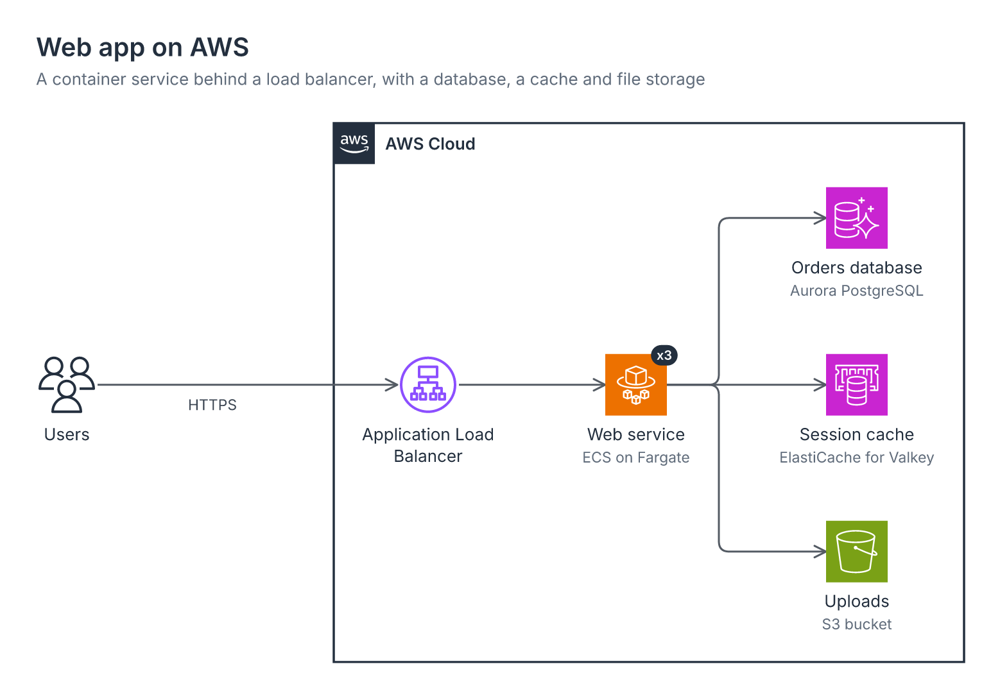</a> | <a href="aws-serverless-api.svg">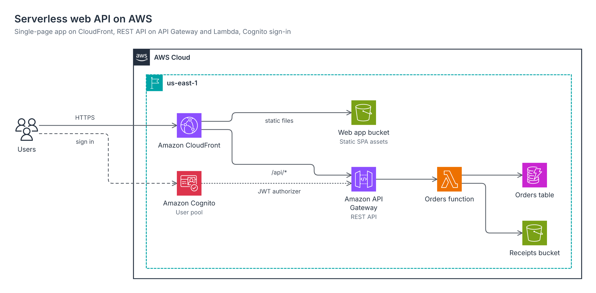</a> |
| [`starter`](../skills/diagramify/examples/starter.yaml): the `diagramify init` default, a load-balanced container service with its database, cache and bucket in one AWS Cloud group. `diagramify render skills/diagramify/examples/starter.yaml -o examples/starter -f svg,png` | [`aws-serverless-api`](../skills/diagramify/examples/aws-serverless-api.yaml): CloudFront serves a single-page app from S3 and sends `/api/*` to API Gateway, Lambda and DynamoDB, with a Cognito JWT authorizer. `diagramify render skills/diagramify/examples/aws-serverless-api.yaml -o examples/aws-serverless-api -f svg,png` |
|  | <a href="aws-three-tier-dark.svg">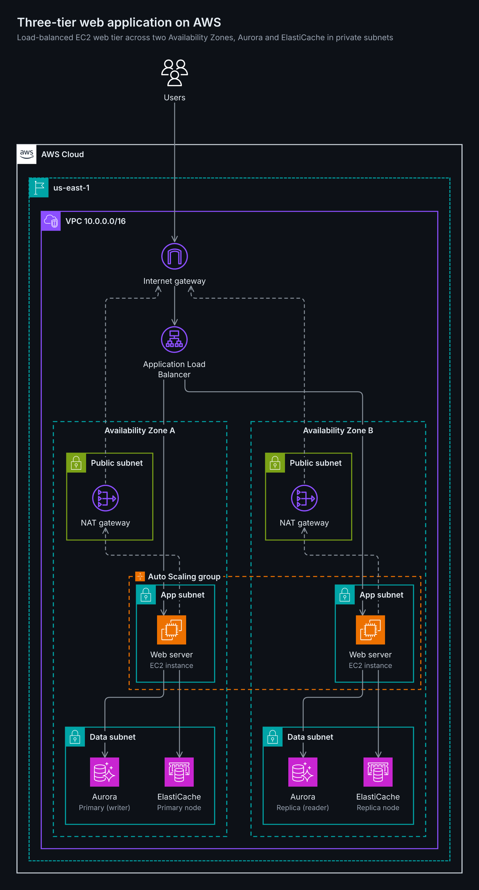</a> |
| [`aws-three-tier`](../skills/diagramify/examples/aws-three-tier.yaml): a VPC across two Availability Zones with public, app and data subnets, NAT gateways, an ALB, and one Auto Scaling group drawn across both zones with `around:`. `diagramify render skills/diagramify/examples/aws-three-tier.yaml -o examples/aws-three-tier -f svg,png` | [`aws-three-tier-dark`](../skills/diagramify/examples/aws-three-tier-dark.yaml): the same diagram with `theme: dark`. `diagramify render skills/diagramify/examples/aws-three-tier-dark.yaml -o examples/aws-three-tier-dark -f svg,png --theme dark` |
|  | <a href="aws-data-lake.svg">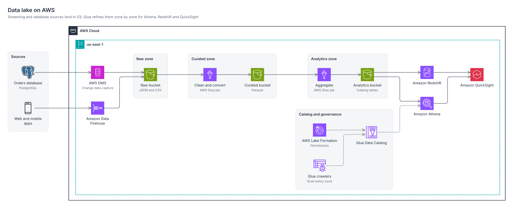</a> |
| [`aws-event-driven`](../skills/diagramify/examples/aws-event-driven.yaml): an EventBridge bus fans orders out to a Step Functions workflow, an SQS billing queue and an SNS topic, with numbered `step:` edges on the main path. `diagramify render skills/diagramify/examples/aws-event-driven.yaml -o examples/aws-event-driven -f svg,png` | [`aws-data-lake`](../skills/diagramify/examples/aws-data-lake.yaml): Firehose and DMS land data in raw, curated and analytics zones refined by Glue jobs, with the catalog and Lake Formation below and Athena, Redshift and QuickSight on top. `diagramify render skills/diagramify/examples/aws-data-lake.yaml -o examples/aws-data-lake -f svg,png` |
| <a href="aws-genai-rag.svg">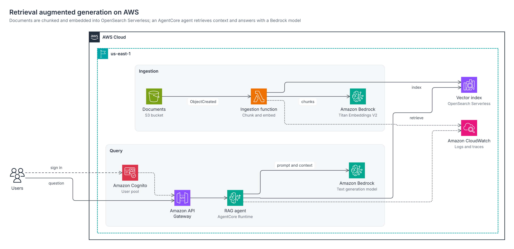</a> | <a href="aws-hybrid-network.svg">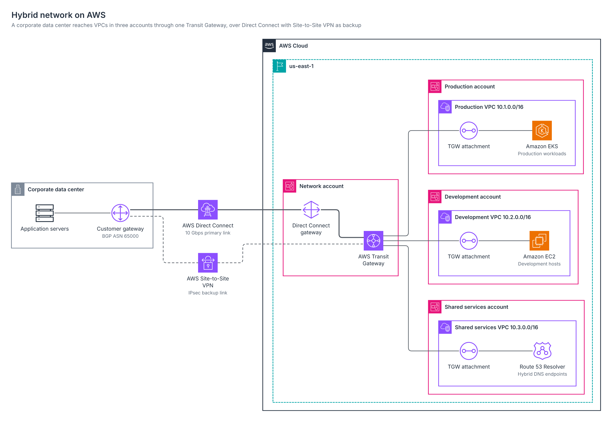</a> |
| [`aws-genai-rag`](../skills/diagramify/examples/aws-genai-rag.yaml): an ingestion lane (S3, Lambda, Titan embeddings) and a query lane (Cognito, API Gateway, a Bedrock AgentCore agent, a Bedrock model) meet at an OpenSearch Serverless vector index. `diagramify render skills/diagramify/examples/aws-genai-rag.yaml -o examples/aws-genai-rag -f svg,png` | [`aws-hybrid-network`](../skills/diagramify/examples/aws-hybrid-network.yaml): a corporate data center reaches VPCs in three AWS accounts through a Transit Gateway, over Direct Connect with a Site-to-Site VPN backup. `diagramify render skills/diagramify/examples/aws-hybrid-network.yaml -o examples/aws-hybrid-network -f svg,png` |
| <a href="ml-platform.svg">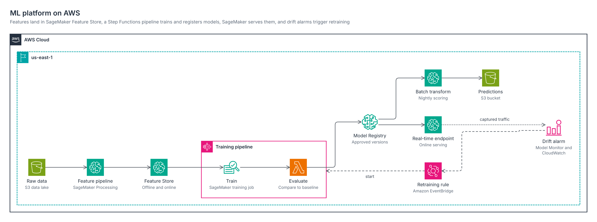</a> | <a href="github-actions-cicd.svg">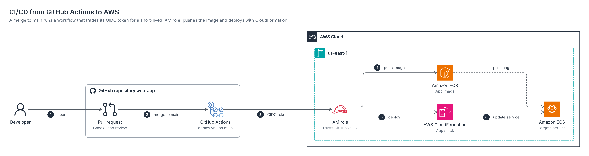</a> |
| [`ml-platform`](../skills/diagramify/examples/ml-platform.yaml): SageMaker Processing into Feature Store, a Step Functions training pipeline, Model Registry, batch and real-time serving, and a drift alarm that starts retraining. `diagramify render skills/diagramify/examples/ml-platform.yaml -o examples/ml-platform -f svg,png` | [`github-actions-cicd`](../skills/diagramify/examples/github-actions-cicd.yaml): a merge to main runs GitHub Actions, which trades its OIDC token for an IAM role, pushes to ECR and deploys ECS with CloudFormation. `diagramify render skills/diagramify/examples/github-actions-cicd.yaml -o examples/github-actions-cicd -f svg,png` |
|  | <a href="gcp-streaming-analytics.svg">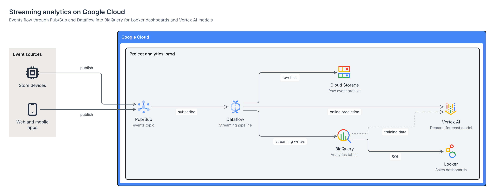</a> |
| [`gcp-web-app`](../skills/diagramify/examples/gcp-web-app.yaml): Google Cloud product cards (`look: card`), a global load balancer with Cloud CDN and Cloud Armor in front of Cloud Run, Cloud SQL, Memorystore and Secret Manager. `diagramify render skills/diagramify/examples/gcp-web-app.yaml -o examples/gcp-web-app -f svg,png` | [`gcp-streaming-analytics`](../skills/diagramify/examples/gcp-streaming-analytics.yaml): Pub/Sub and Dataflow stream events into BigQuery, Cloud Storage and a Vertex AI model, with Looker dashboards on BigQuery. `diagramify render skills/diagramify/examples/gcp-streaming-analytics.yaml -o examples/gcp-streaming-analytics -f svg,png` |
|  | <a href="azure-aks-platform.svg">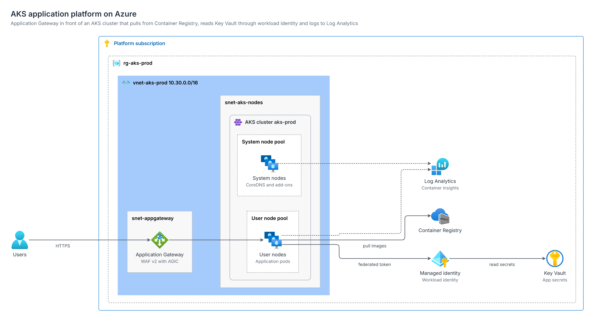</a> |
| [`azure-web-app`](../skills/diagramify/examples/azure-web-app.yaml): Front Door to App Service with VNet integration, reaching Azure SQL and Key Vault through private endpoints, with Azure's filled arrowheads. `diagramify render skills/diagramify/examples/azure-web-app.yaml -o examples/azure-web-app -f svg,png` | [`azure-aks-platform`](../skills/diagramify/examples/azure-aks-platform.yaml): Application Gateway in front of an AKS cluster with system and user node pools, Container Registry, workload identity to Key Vault, and Log Analytics. `diagramify render skills/diagramify/examples/azure-aks-platform.yaml -o examples/azure-aks-platform -f svg,png` |
|  |  |
| [`k8s-workload`](../skills/diagramify/examples/k8s-workload.yaml): the official Kubernetes icons inside a namespace: Ingress, Service, Deployment, ReplicaSet, Pods, HPA, ConfigMap, Secret and a PVC bound to a PersistentVolume. `diagramify render skills/diagramify/examples/k8s-workload.yaml -o examples/k8s-workload -f svg,png` | [`multi-cloud`](../skills/diagramify/examples/multi-cloud.yaml): AWS, Google Cloud and Azure in their own vendor frames, federated to one Okta tenant and joined at a colocation router by Direct Connect, Partner Interconnect and ExpressRoute. `diagramify render skills/diagramify/examples/multi-cloud.yaml -o examples/multi-cloud -f svg,png` |
|  | <a href="system-design-chat.svg">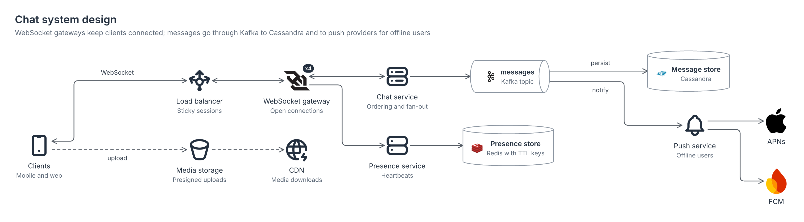</a> |
| [`system-design-url-shortener`](../skills/diagramify/examples/system-design-url-shortener.yaml): vendor-neutral `generic:` icons and product logos, from CDN, load balancer and API servers to Redis, PostgreSQL and a Kafka, Flink and ClickHouse click pipeline. `diagramify render skills/diagramify/examples/system-design-url-shortener.yaml -o examples/system-design-url-shortener -f svg,png` | [`system-design-chat`](../skills/diagramify/examples/system-design-chat.yaml): shape nodes for a whiteboard look (cylinders for stores, a queue for the Kafka topic) around WebSocket gateways, chat, presence, push and media services. `diagramify render skills/diagramify/examples/system-design-chat.yaml -o examples/system-design-chat -f svg,png` |
| <a href="observability-stack.svg">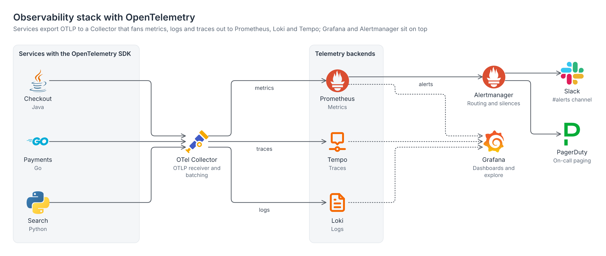</a> |  |
| [`observability-stack`](../skills/diagramify/examples/observability-stack.yaml): OpenTelemetry SDKs export to a Collector that fans out to Prometheus, Loki and Tempo, with Grafana on top and Alertmanager paging Slack and PagerDuty. `diagramify render skills/diagramify/examples/observability-stack.yaml -o examples/observability-stack -f svg,png` | [`c4-container`](../skills/diagramify/examples/c4-container.yaml): a C4 container view built from shapes: two people, a `c4:boundary` system, its containers and database, and grey external systems. `diagramify render skills/diagramify/examples/c4-container.yaml -o examples/c4-container -f svg,png` |
